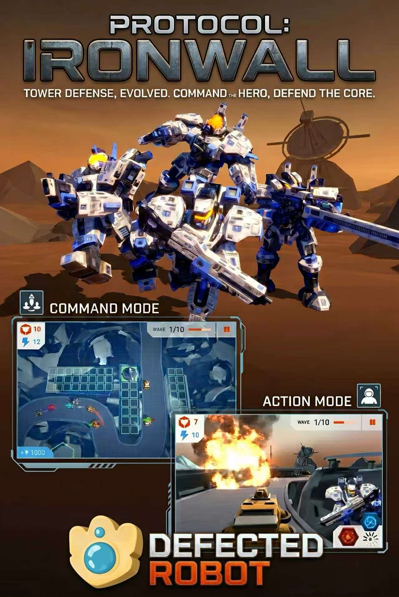

<h1>Protocol: IronWall</h1>

<strong>Deploy towers from above. Pilot the hero mech from the cockpit.</strong>

ECE4300 Human–Computer Interaction · Team Defected Robot · Windows

  <a href="media/gameplay-demo.mp4"><strong>Watch the gameplay demo</strong></a>
  &nbsp;·&nbsp;
  <a href="https://github.com/Penguinblast/protocol-ironwall/releases"><strong>Download the Windows build</strong></a>
  &nbsp;·&nbsp;
  <a href="README.zh-CN.md"><strong>中文</strong></a>

## Two ways to defend the core

| Command Mode | Action Mode |
| --- | --- |
| Survey the battlefield from above, place towers, and let the hero navigate and engage enemies autonomously. | Switch into the cockpit to steer the hero, fire missiles, and use energy pulse and flame jet abilities. |

A two-handed fist gesture switches views mid-wave. The same hands that place defenses can take over the mech when a lane needs direct support.

## Play on Windows

1. Download the Windows x64 ZIP from [Releases](https://github.com/Penguinblast/protocol-ironwall/releases) and extract the whole archive.
2. Connect a compatible Leap Motion Controller and start the [Ultraleap hand-tracking software](https://docs.ultraleap.com/hand-tracking/desktop-setup.html).
3. Open **Final Project.exe** inside the extracted folder. Keep the data folder and DLLs beside the executable.

| Where | Gesture | Action |
| --- | --- | --- |
| Menus | Move the left hand / make a left fist | Move the cursor / confirm |
| Command | Pinch with the right hand | Select or place a tower |
| Either mode | Make both hands into fists | Switch views |
| Action | Tilt one hand / tilt both hands forward | Steer / move forward |
| Action | Pinch with the right hand | Fire a tactical missile |
| Action | Push both hands forward | Trigger the energy pulse |
| Action | Pinch with both hands | Activate the flame jet |

## How the interaction works

Ultraleap tracking provides hand pose data. The C# interaction scripts translate pose and gesture states into cursor, placement, movement, and skill inputs. The current view gates combat controls so the same gesture can have a different purpose in each mode.

- [Hand tracking and cursor input](source/LeftController.cs) maps left-hand movement and grip to input.
- [Right-hand recognition](source/RighthandDetector.cs) detects pinch and fist states.
- [Skill input](source/SkillController.cs) maps gestures to cockpit controls and abilities.
- [View state](source/Viewmanager.cs) coordinates the active mode and its gesture controls.

See [Source and dependencies](docs/SOURCE.md) for the original editor version and the scope of the published code.

## Team Defected Robot

| Team member | Contribution |
| --- | --- |
| **Zuhang Li** | Hand-driven cursor tracking and gesture recognition for both tower defense and action gameplay |
| Zheyuan Zhu | Tower and robot models, Leap Motion recognition |
| Linjun Jiang | Robot movement, attacks and skills, control system |
| Dongchu Xie | Autonomous movement, attacks and skills, poster and project overview |
