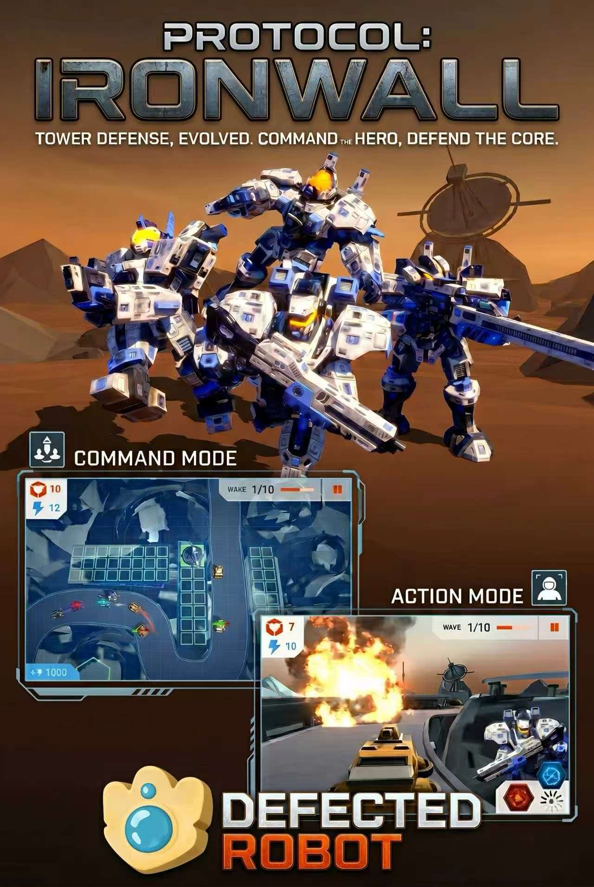

<h1>Protocol: IronWall</h1>

<strong>俯视部署防御塔，切入驾驶舱操控英雄机甲。</strong>

ECE4300 人机交互 · Defected Robot 团队 · Windows

<a href="media/gameplay-demo.mp4">演示视频（MP4）</a> · <a href="https://github.com/Penguinblast/protocol-ironwall/releases">下载试玩版</a> · <a href="README.md">English</a>

## 两种玩法

- **指挥模式**采用俯视视角。玩家部署防御塔，英雄机甲自主移动并攻击敌人。
- **行动模式**切入第一人称驾驶舱。玩家直接控制机甲移动和转向，并释放导弹、能量脉冲或火焰喷射。

玩家在同一波次中双手握拳即可切换视角，在全局布防与直接支援之间切换。

## Windows 试玩

1. 从 [Releases](https://github.com/Penguinblast/protocol-ironwall/releases) 下载并完整解压 Windows x64 试玩包。
2. 连接兼容的 Leap Motion Controller 并启动 [Ultraleap 手部追踪软件](https://docs.ultraleap.com/hand-tracking/desktop-setup.html)。
3. 双击解压目录中的 **Final Project.exe**，保留同目录的数据文件夹及 DLL。

| 场景 | 手势 | 操作 |
| --- | --- | --- |
| 菜单 | 移动左手／左手握拳 | 移动光标／确认 |
| 指挥 | 右手捏合 | 选择或放置防御塔 |
| 两种模式 | 双手同时握拳 | 切换视角 |
| 行动 | 单手倾斜／双手向前倾斜 | 转向／前进 |
| 行动 | 右手捏合 | 发射战术导弹 |
| 行动 | 双手前推 | 释放能量脉冲 |
| 行动 | 双手捏合 | 启动火焰喷射 |

## 交互实现

Ultraleap 追踪手部姿态，C# 脚本将其映射为光标、布防、移动和技能输入。视角状态控制技能是否响应，使同一个手势在两个模式中可以触发不同操作。

- [光标与左手输入](source/LeftController.cs)
- [右手捏合与握拳识别](source/RighthandDetector.cs)
- [驾驶舱技能输入](source/SkillController.cs)
- [视角状态切换](source/Viewmanager.cs)

[源码与依赖说明](docs/SOURCE.md)列出了原工程使用的编辑器和公开代码范围。

## 团队分工

| 成员 | 分工 |
| --- | --- |
| **Zuhang Li（李祖航）** | 手势光标追踪、行动与塔防两种玩法的手势识别 |
| Zheyuan Zhu | 塔防与机甲模型、Leap Motion 手势识别 |
| Linjun Jiang | 机甲运动、攻击与技能、控制系统 |
| Dongchu Xie | 自主移动、攻击与技能、海报与项目介绍 |
